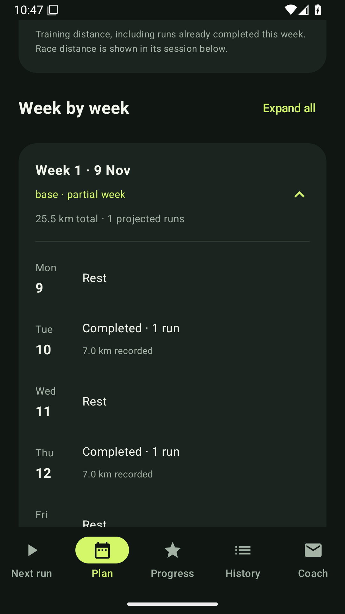
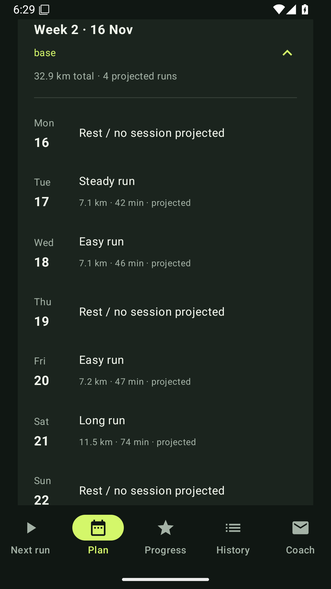

# CoachMeSimple for Android

An on-device running coach for Android, adapted from [pettifordo/pacecraft](https://github.com/pettifordo/pacecraft). Native Kotlin + Jetpack Compose. The deterministic training engine and run history are the product; coaching comments use local rules, with no AI dependency.

## Try the APK

[Download CoachMeSimple 0.4.0 APK](https://github.com/pettifordo/pacecraft-android/releases/download/v0.4.0-test/CoachMeSimple-0.4.0-test.apk) and send the file to your tester. On their Android phone, open the downloaded file, allow **Install unknown apps** for the app opening it if prompted, and install CoachMeSimple. Android 9 or later is required. The test APK is signed with a development key and is not a Google Play release.

Start with **Explore with sample history** to inspect all five tabs without granting access. Demo history is isolated from real history and edits are disabled while it is active. Exit demo before connecting data or editing settings.

For real data, install/update Health Connect where needed, enable sharing from the watch/recording app into Health Connect, and allow CoachMeSimple to read **exercise sessions and distance**. Heart rate and elevation are optional. On supported devices, allow **history** access to import the 26-week window. Without that permission, the platform may only expose the 30 days before first permission grant plus subsequent records; CoachMeSimple will not invent missing history. Manual run entry works independently of Health Connect.

[Wear OS companion APK](https://github.com/pettifordo/pacecraft-android/releases/download/v0.4.0-test/CoachMeSimple-Wear-0.4.0-test.apk): install separately on your paired Pixel Watch / Galaxy Watch. See [watch setup](docs/WEAR_OS.md). Phone and watch APKs must come from the same release.

You can also choose **Start without run history** for a provisional ability-based plan and run/walk sessions.

## Implemented

- Beginner/run-walk onboarding, measured-history graduation, goal feasibility/trajectory/adherence, session length/pace/day adjustment previews and reset, one-off unavailable dates.
- Full plan PDF, next-week calendar and structured workout sharing; optional morning/completion notifications and permitted daily background history refresh.
- Wear OS companion: explicit workout transfer, timed work/recovery steps, pace targets, pause/resume, measured GPS/optional HR and durable completed-run return.
- Hills, strides, progression, threshold cruise blocks and peak interval ladders, with phase/load/time/volume guards.
- Optional Health Connect resting-HR/HRV baseline signals, cross-training toggle, help/glossary and run recaps.
- Prescribed pace bands in every planned run. Intervals show actual rep count, timed work and jog recoveries, with separate work/recovery paces. Session detail includes warm-up, every rep, and cool-down. Metric and imperial paces convert together.
- Whole-plan tab: weekly projection through race day (up to 30 weeks), expandable days and session steps, weekly training-volume chart, and a fortnight for goals without a race date. Later sessions are forecasts; they adapt after real runs and check-ins.
- Next-run prescription, including pace bands, actual structured-step totals, reasons, skip-day and check-in actions.
- Health Connect running and treadmill sessions, distance, optional heart rate/elevation, plus supported cycling/swimming/rowing/strength cross-training for load.
- Paginated 26-week import, source-scoped aggregates, duplicate-run cleaning, refresh on foreground, manual history and run detail.
- Critical Speed / D′ regression, weighted effort frontier, endurance exponent, uncertainty bands and race-distance durability requirements.
- Rolling acute/chronic load, calendar-week ramp checks, cross-training fatigue and headroom, safety priority, feedback restrictions, taper/down weeks, race recovery.
- Goal distance/date/time, session count, unavailable weekdays, preferred long-run day, intensity, weekly/time caps, metric/imperial display and optional heart-rate profile.
- Local atomic persistence, run-to-prescription matching, local-data deletion and permission-revocation handling. No analytics, account or cloud AI. Explicit sharing and Wear OS Data Layer transfer move only the data you choose.
- Pure JVM engine tests, Android lint and CI APK artifacts.

## Build

Install JDK 17 and Android SDK platform 36/build-tools 35.0.0 (or open in Android Studio). Set `ANDROID_HOME`, or put `sdk.dir=/path/to/Android/sdk` in untracked `local.properties`.

```sh
./gradlew :engine:test :app:testDebugUnitTest :app:lintDebug :app:assembleDebug :wear:testDebugUnitTest :wear:lintDebug :wear:assembleDebug
```

APK: `app/build/outputs/apk/debug/app-debug.apk`. CI builds are downloadable under Actions → Android checks and test APK → Artifacts. CI development signatures can differ from this first APK; uninstall the older build before installing one signed by a different development key (uninstalling clears local data).

## Structure

- `engine/`: Android-independent Kotlin models, analysis, planner and rules comments.
- `wear/`: companion workout UI, active-exercise service and durable transfer.
- `shared/`: versioned selected-workout/completed-run contract.
- `app/`: Compose UI, Health Connect adapter, lifecycle refresh and private JSON store.
- `docs/PORTING.md`: source revision, parity boundaries and known gaps.
- `docs/TESTING.md`: friend-testing instructions.
- `docs/PLAY_RELEASE.md`: publishing later using `pettifordo@gmail.com`.

This is a broad Android testing release. Read the [parity checklist](docs/PARITY.md) and porting notes before comparing prescriptions across platforms. Physical paired-watch GPS/HR, battery behaviour and real-vendor Health Connect need device testing; the Android planner is not a byte-for-byte Swift port.

## Emulator screenshots

[View the actual Android screenshots](docs/screenshots) captured on a standard Android 15 emulator with demo history. The [emulator workflow](.github/workflows/screenshots.yml) exercises all five tabs and verifies that demo history does not enter the real local cache. It can be rerun from Actions.

| Whole plan | Expanded week |
| --- | --- |
|  |  |
